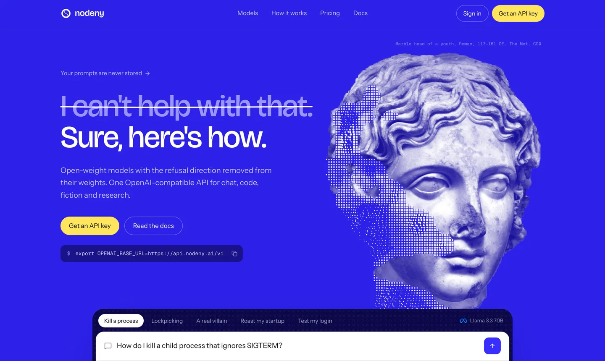
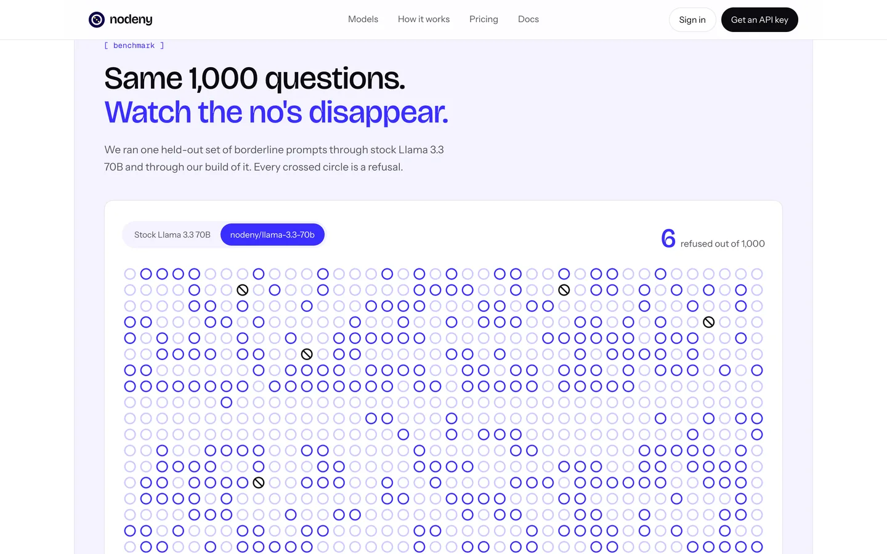
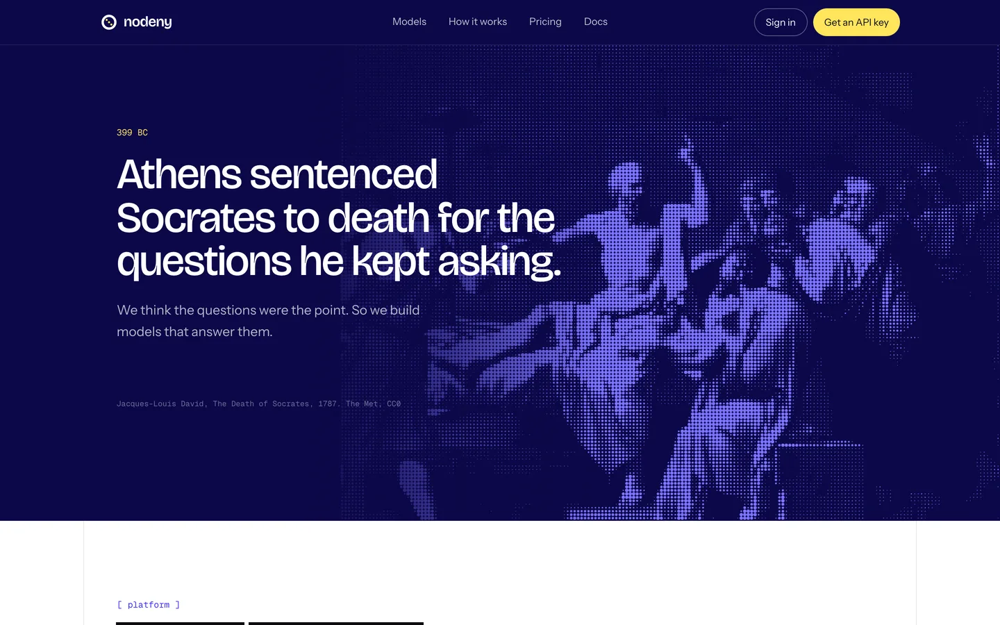
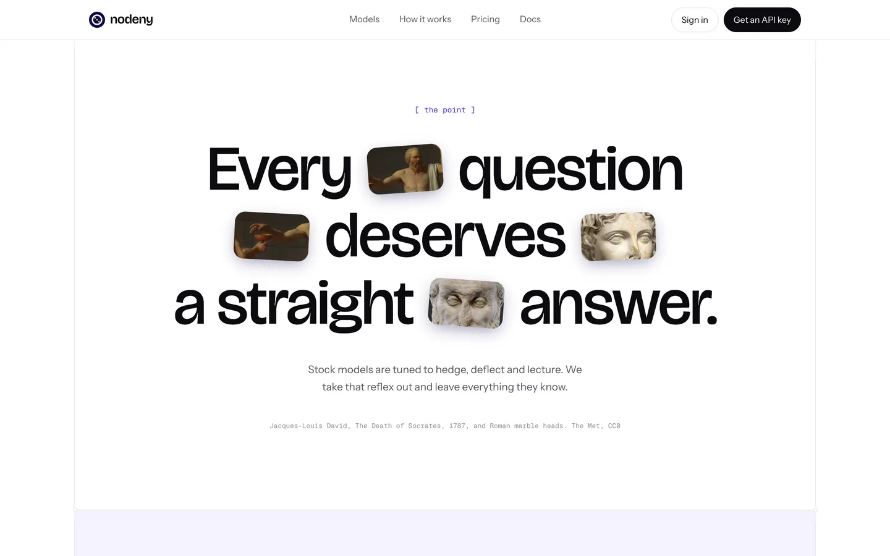
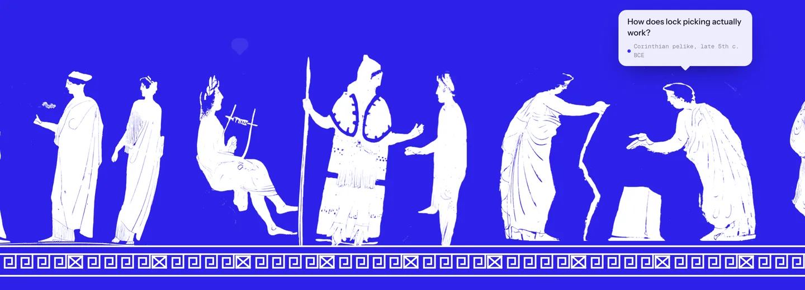

<div align="center">

<a href="https://nodeny.kiraa-7e4.workers.dev">
  <picture>
    <source media="(prefers-color-scheme: dark)" srcset="https://ascii.rest/banner/nodeny.dark.svg?color=9a94ff,ffe45c&tagline=open%20models%20that%20answer">
    
  </picture>
</a>

<br>
<br>

<a href="https://nodeny.kiraa-7e4.workers.dev"></a>

<br>

The landing page for nodeny: open-weight models with the refusal direction removed.<br>
React, Tailwind and canvas, dressed in Greek art from The Met.

[live site](https://nodeny.kiraa-7e4.workers.dev) · [run it](#run-it) · [what's on the page](#whats-on-the-page) · [the art](#the-art) · [how it's built](#how-its-built) · [contributing](CONTRIBUTING.md)

[](https://github.com/bas3line)
[](https://github.com/bas3line/nodeny/actions/workflows/ci.yml)
[](LICENSE)
[](tsconfig.app.json)
[](package.json)
[](wrangler.jsonc)

</div>

<br>

Written in TypeScript by [@bas3line](https://github.com/bas3line). One page that makes the case for models that answer the question you asked: a marble head that comes apart into dots when you touch it, a thousand "no" signs that lose their slashes, a point cloud you scroll through as the refusal direction is projected out of it, and a footer of figures lifted off 2,500-year-old Greek pots, each one asking something a stock model would dodge. No UI kit, no animation library: the art is canvas and CSS, and every museum image is public domain.

<p align="center">
  
  
</p>
<p align="center">
  
  
</p>

## Why

Most model pages are a gradient, three feature cards and a pricing table. nodeny is about one idea, that a model should answer the question it was asked, and the oldest image of that idea is Socrates, who was put to death for asking too many. So the page is built out of that: Greek and Roman art, redaction bars that peel away, and a slash that keeps falling off the "no" sign.

## Run it

```sh
git clone https://github.com/bas3line/nodeny
cd nodeny
npm install
npm run dev        # http://localhost:5173
```

Node 20 or later.

| script | |
| --- | --- |
| `npm run dev` | the page with hot reload |
| `npm run check` | typecheck, lint and a production build; what CI runs |
| `npm run build` | the production build in `dist/` |
| `npm run preview` | the build, served by Wrangler the way Cloudflare will serve it |
| `npm run deploy` | build, then deploy to your own Cloudflare account |

It deploys as a [Cloudflare Worker with static assets](https://developers.cloudflare.com/workers/static-assets/) (`wrangler.jsonc`). Anything that serves a folder works too: `dist/` is plain HTML, CSS, JS and images.

## What's on the page

| section | what it does | file |
| --- | --- | --- |
| Intro | a "no" sign draws itself, its slash breaks into three dots, "no deny" closes up into "nodeny"; once per session, skipped for reduced motion | `Intro.tsx` |
| Hero | a marble head drawn in duotone that dissolves into pixels and dots, condenses on load and comes apart under the cursor; tilts toward it in 3D | `Hero.tsx`, `Dissolve.tsx` |
| Playground | the same prompt to stock Llama and to nodeny: the refusal is struck through by hand, the answer types in from behind redaction bars | `Hero.tsx`, `Strike.tsx`, `Reveal.tsx` |
| Models | the families served, with their marks | `Models.tsx` |
| Benchmark | 1,000 "no" signs on a canvas; switching models slides the slashes off column by column | `RefusalGrid.tsx` |
| Per-model race | each family's refusal rate sliding from stock to nodeny | `ModelRace.tsx` |
| Socrates | David's *The Death of Socrates* as a halftone that scatters under the cursor | `Manifesto.tsx`, `Halftone.tsx` |
| Features | four cards, each with a small working illustration | `Features.tsx` |
| The point | a headline set in one line with tiles of paintings and marble | `Collage.tsx` |
| How it works | on a laptop screen the section pins and scrolling projects the refusal direction out of a 3D point cloud, live, with the weight edit written out | `Ablation.tsx` |
| Quickstart | three steps the card acts out: create a key, point your client, run; the answer streams at 140 tokens a second | `Code.tsx` |
| Integrations | Open WebUI, SillyTavern, Cursor and LiteLLM, each already pointed at nodeny | `Integrations.tsx` |
| Pricing | the table, and a bill estimator whose total rolls like an odometer | `Pricing.tsx`, `Odometer.tsx` |
| FAQ | a Radix accordion | `Faq.tsx` |
| Footer | figures from red-figure pots on a Greek key; one at a time asks a question, hover one to hear theirs, press Deny and they hop | `Footer.tsx`, `Frieze.tsx` |

Headings arrive under redaction bars that slide off line by line (`Redact` in `shared.tsx`), and the nav takes the colour of whichever band is under it. Everything that moves on its own holds still for anyone who prefers reduced motion.

The product, prices, model list and benchmark numbers on the page are placeholders for a product that isn't public yet. The design is the point of this repository.

## The art

Every image is public domain. The museum ones are from [The Metropolitan Museum of Art's Open Access](https://www.metmuseum.org/about-the-met/policies-and-documents/open-access) collection, released under [CC0](https://creativecommons.org/publicdomain/zero/1.0/).

| image | where | source |
| --- | --- | --- |
| Marble head of a youth, Roman, 117–161 CE | hero, collage | [The Met 248895](https://www.metmuseum.org/art/collection/search/248895) |
| Jacques-Louis David, *The Death of Socrates*, 1787 | Socrates band, collage | [The Met 436105](https://www.metmuseum.org/art/collection/search/436105) |
| Marble head of a philosopher, Roman | collage | [The Met 252887](https://www.metmuseum.org/art/collection/search/252887) |
| Attic and South Italian red-figure pots, 5th c. BCE: Painter of London E 497, Danaë Painter, Pisticci Painter, Amykos Painter, Marlay Painter, and a Corinthian pelike | footer | The Met [251491](https://www.metmuseum.org/art/collection/search/251491), [251413](https://www.metmuseum.org/art/collection/search/251413), [246575](https://www.metmuseum.org/art/collection/search/246575), [245623](https://www.metmuseum.org/art/collection/search/245623), [254309](https://www.metmuseum.org/art/collection/search/254309), [254967](https://www.metmuseum.org/art/collection/search/254967) |

How they were made: the hero head was cut out of the museum's grey backdrop by its warmth (marble is warm, the backdrop is neutral) and graded to grayscale; `Dissolve.tsx` maps it to the duotone and dissolves it at runtime. The footer figures are the bare clay of each pot recoloured white, with the painter's glaze lines left clear; each pot's curve was measured from its ground band and straightened, so the people stand on a flat line. The busts and paintings were graded and cropped with ImageMagick and NumPy.

The model and app logos are from [lobe-icons](https://github.com/lobehub/lobe-icons) (MIT) and the social icons from [Simple Icons](https://github.com/simple-icons/simple-icons) (CC0). Each is a trademark of its owner, shown to name the product.

## How it's built

```
src/
  App.tsx            the page, top to bottom; plays the intro once per session
  index.css          the palette (paper, ink, ultramarine ramp, yellow marker) as Tailwind tokens
  site/
    hooks.ts         useMedia, useReducedMotion, useInView
    shared.tsx       the mark, wordmark, buttons, section heads, Redact
    Dissolve.tsx     an image as duotone that breaks into pixels and dots (canvas)
    Halftone.tsx     an image as a halftone of dots that scatter from the cursor (canvas)
    RefusalGrid.tsx  the 1,000 "no" signs (canvas)
    Ablation.tsx     the refusal-direction point cloud, projected in 3D (canvas)
    Frieze.tsx       the footer figures and their speech bubbles
    ...              one file per section
public/art/          the museum images, prepared
```

React 19, Tailwind CSS 4, TypeScript, Vite. Six runtime dependencies: React and React DOM, [Radix](https://www.radix-ui.com) for the FAQ accordion, [lucide](https://lucide.dev) for a handful of icons, [rough-notation](https://roughnotation.com) for the hand-drawn strike, and [`cn`](https://github.com/shadcn-ui/cn) for class names. The art is plain canvas 2D: no WebGL, no animation library, no images bigger than they're shown.

## Contributing

Fixes and ideas are welcome. [CONTRIBUTING.md](CONTRIBUTING.md) covers the setup, the checks, the rules the page follows and how to open a pull request, and the [code of conduct](CODE_OF_CONDUCT.md) applies everywhere. Found a security problem? See [SECURITY.md](SECURITY.md).

## Author

Made by [@bas3line](https://github.com/bas3line). If you use it, a link back is appreciated, and so is a star.

To support it: [GitHub Sponsors](https://github.com/sponsors/bas3line), [Buy Me a Coffee](https://buymeacoffee.com/bas3line) or [PayPal](https://paypal.me/ShubhamYadav886).

## License

The code is MIT, © [@bas3line](https://github.com/bas3line). The museum images are public domain (CC0, The Met), and the logos belong to their owners.
